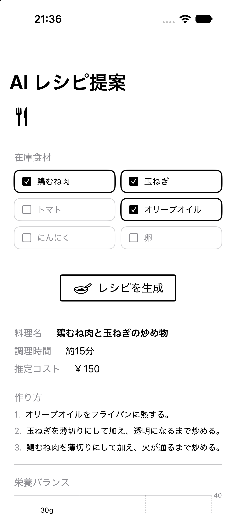

# RecipeAISample

オンデバイス生成 AI フレームワーク **FoundationModels(`@Generable` / `LanguageModelSession`)** と **Swift Charts** を使った、レシピ・栄養バランス提案の検証用サンプルです。  

在庫・原価管理アプリ [Costo](https://github.com/mickey-wt-pkmn/Costo) の次期構想(在庫食材からのレシピ提案機能)の技術検証として作成しました。

## スクリーンショット
| AI レシピ提案 |
| :---: |
|  |

## 主な機能・構成
- **構造化 AI 生成(`FoundationModels`)**
  - `@Generable` と `@Guide` を用いて、選択した在庫食材から「料理名・調理時間・推定コスト・三大栄養素(g)・調理手順」を `struct`(`RecipeSuggestion`)として生成します
  - `SystemLanguageModel.default.isAvailable` で Apple Intelligence の利用可否を判定し、未対応環境ではフォールバック応答を返す設計にしています
- **グラフ可視化(`Swift Charts`)**
  - 生成されたタンパク質・脂質・炭水化物のグラム数を `BarMark` で可視化します
- **状態管理 / テスト**
  - SwiftUI + `@Observable` による MVVM 構成
  - `RecipeAISampleTests` では **Swift Testing(`@Test` / `#expect`)** でテストを実装しています
  
## 動作環境
- Xcode 27.2 / iOS 27.2